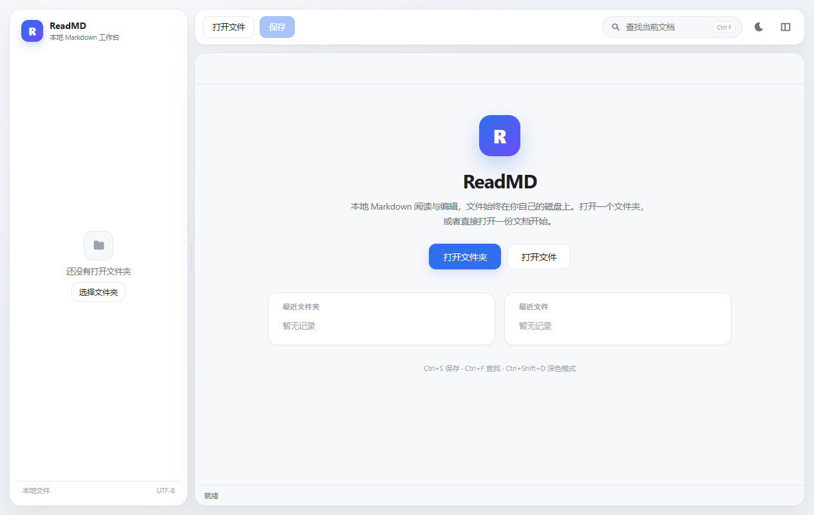
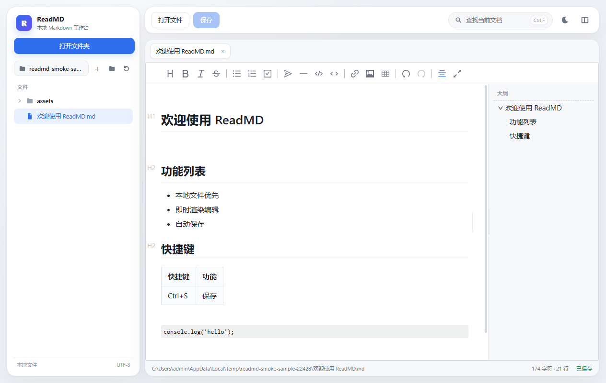
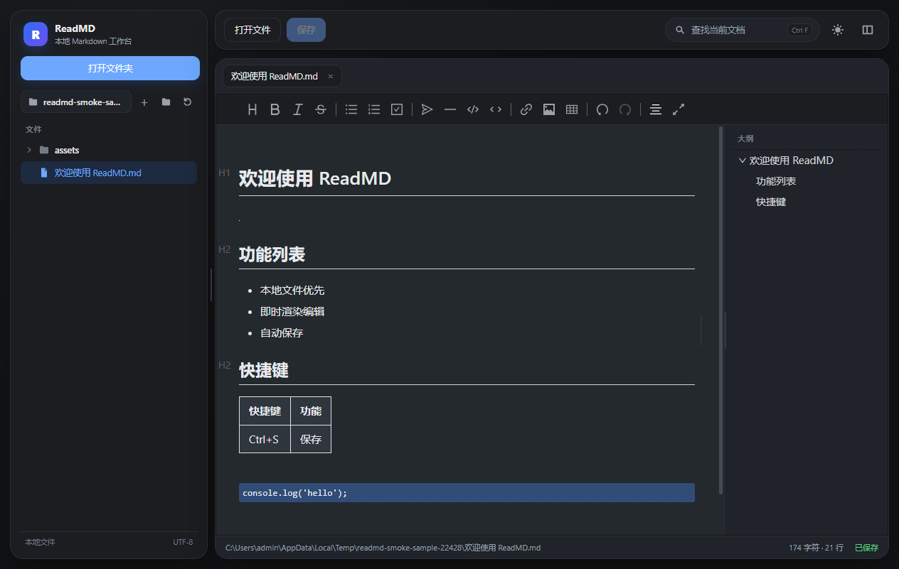
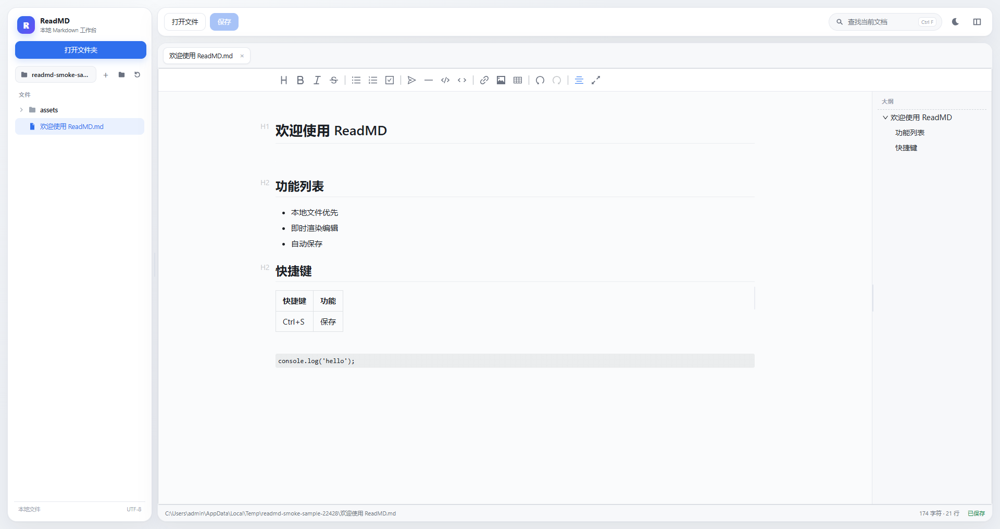

<p align="center">
  
</p>

<h1 align="center">ReadMD</h1>

<p align="center">
  <strong>本地优先的 Markdown 阅读与编辑桌面应用</strong><br>
  打开文件夹就能写，所有文档仍然是磁盘上的普通 <code>.md</code> 文件。
</p>

<p align="center">
  <em>A local-first Markdown reader &amp; editor built with Electron and Vditor.</em>
</p>

<p align="center">
  <a href="LICENSE"></a>
  
  
  
  
</p>

<p align="center">
  <a href="#功能特性">功能特性</a> ·
  <a href="#界面预览">界面预览</a> ·
  <a href="#快速开始">快速开始</a> ·
  <a href="#快捷键">快捷键</a> ·
  <a href="#技术栈与架构">技术栈</a> ·
  <a href="#开发与测试">开发与测试</a> ·
  <a href="#常见问题">常见问题</a> ·
  <a href="#参与贡献">参与贡献</a>
</p>

> **项目状态**：`v0.4.0`，Windows 优先，功能可用但仍在快速迭代。欢迎提交 Issue 和 Pull Request。
>
> **设计原则**：文件留在本地、格式保持开放、编辑器内核复用成熟项目、界面保持轻量。
>
> **变更记录**：[CHANGELOG.md](CHANGELOG.md) · **贡献指南**：[CONTRIBUTING.md](CONTRIBUTING.md)

---

## 目录

- [为什么是 ReadMD](#为什么是-readmd)
- [功能特性](#功能特性)
- [界面预览](#界面预览)
- [快速开始](#快速开始)
- [使用指南](#使用指南)
- [快捷键](#快捷键)
- [技术栈与架构](#技术栈与架构)
- [项目结构](#项目结构)
- [开发与测试](#开发与测试)
- [安全与隐私](#安全与隐私)
- [已知限制](#已知限制)
- [路线图](#路线图)
- [参与贡献](#参与贡献)
- [常见问题](#常见问题)
- [许可证](#许可证)
- [致谢](#致谢)

---

## 为什么是 ReadMD

很多 Markdown 工具要么把内容锁进数据库，要么功能很全但界面偏重。ReadMD 的取舍是：

- **本地优先**：文档就是磁盘上的 `.md` 文件，不导入私有数据库，卸载程序不会影响文件。
- **像 Typora 一样写作**：使用 Vditor 的即时渲染（IR）模式，光标所在行显示 Markdown 语法，其他位置显示排版结果。
- **文件树 + 多标签**：适合管理一个文档目录，而不是只打开单个文件。
- **复用成熟内核**：Markdown 解析、富文本编辑、数学公式、Mermaid、代码高亮交给 Vditor；ReadMD 只负责桌面外壳和本地文件工作流。
- **开源可改**：MIT 许可证，代码结构简单，方便二次开发。
- **离线可用**：Vditor 的图标、高亮、KaTeX、Mermaid 等资源全部随程序分发，不依赖 CDN。

如果你只想要一个功能最全的现成开源编辑器，[MarkText](https://github.com/marktext/marktext) 也是很好的选择；ReadMD 的定位是更轻、更贴近本地文件夹工作流、方便按需定制。

---

## 功能特性

### 编辑与阅读

- 即时渲染（IR）模式，接近 Typora 的写作体验
- GFM：表格、任务列表、删除线、自动链接、脚注
- 代码块语法高亮与行号
- KaTeX 数学公式、Mermaid 流程图、思维导图等 Vditor 扩展能力
- 右侧标题大纲，点击跳转
- 正文右下角悬浮“回到顶部”按钮，向下滚动后出现
- 深色 / 浅色主题同步切换
- 当前文档内查找，显示匹配数量
- 正文宽度、侧边栏宽度、大纲面板宽度均可拖拽调整；宽窗口/全屏下正文自动居中

### 文件与工作流

- 打开文件夹，左侧懒加载文件树
- 多标签页，未保存状态用圆点标记
- 停止输入约 0.9 秒自动保存，也支持 `Ctrl+S`
- 另存为、新建文件、新建文件夹、重命名
- 删除文件移到系统回收站，可恢复
- 最近打开的文件夹和文件
- 双击 `.md` 文件直接用 ReadMD 打开；可在应用内设为默认打开方式（Windows 会要求用户确认），已运行时复用窗口并新开标签页
- 一次选择多个 Markdown 文件时，全部作为标签页打开
- 记住窗口大小、侧边栏宽度、主题和上次打开的文件
- 点击编辑器工具栏图片按钮、拖拽或粘贴图片，自动保存到文档旁的 `assets/` 文件夹
- 相对路径图片正确显示

### 导出与安全

- 导出 **Word 文档（.docx）**：使用原生 Word 样式，标题、正文、引用、代码块、表格、图片、公式都可以继续在 Word 里编辑
- 导出 **A4 PDF**：宋体正文、1.5 倍以上行距、标准页边距、页脚页码、表格跨页重复表头
- 导出独立 HTML，与 PDF 共用同一套排版
- **导出设置**：通用排版 / 正式排版（首行缩进 2 字符）、页眉、页脚页码、封面、目录，设置会记住
- **封面**：标题自动取文档一级标题，可填写副标题和署名，自动附上导出日期
- **目录**：Word 生成原生目录（带页码，打开时更新）；PDF / HTML 生成可点击跳转的目录
- **批量导出当前文件夹**：Word / PDF / HTML 一次导出整个文件夹，保留子目录结构，重名自动加序号
- 顶部“导出”按钮集中所有入口，文件菜单也保留对应菜单项
- Markdown 渲染默认开启 XSS 过滤
- 渲染进程启用上下文隔离、沙箱，关闭 Node.js 直连
- 文件读写限制在用户主动打开的路径范围内
- Word 导出只读取文档所在目录内的本地图片；三种格式都只允许 https 网络图片，Word 还会拒绝本机/内网 IP 和 `.local` 地址
- 导出文件名会自动清理 Windows 不允许的字符（如 `: * ? " < > |`）
- 外部链接交给系统浏览器打开

### AI 助手（需要自己配置模型）

- 右侧 AI 面板：流式聊天、停止生成、清空对话、切换模型；左缘可拖动调整宽度，双击复位
- 面板与设置页沿用主界面的卡片、控件和深色主题；设置页左侧选择模型，右侧分栏填写，保存按钮固定在底部
- 支持 OpenAI 兼容 / OpenAI / Anthropic / Gemini；内置国内外服务商预设，也可以完全自定义
- API Key 只保存在本机，用系统加密；不会写进源码、日志或渲染进程
- 修改接口地址或接口类型后，旧 API Key 不会继续复用，需要重新填写
- 自动带入当前文档和选区；只能搜索、读取当前文件夹里的 Markdown/文本文件，不跟随符号链接跳出文件夹
- 图片粘贴 / 拖拽 / 上传，视觉模型识别；过大的 GIF 会自动转成静态图片发送
- 上传 PDF / Word / TXT / Markdown，本地提取文字后对话；DOCX 解压后有大小上限，避免压缩炸弹
- AI 修改以 diff 建议呈现，用户确认后才写入；建议会绑定生成时的文档，切换文档或文档已变化时不会误应用
- 撤销只在应用后没有继续编辑时可用，避免覆盖新改动
- 没有工具调用能力的模型，可以用 JSON 文本建议降级
- 默认预置了“智桂 API”配置模板（地址和模型名已填好），第一次使用时只需要在 AI 设置里粘贴一次 API Key

> `.txt` 文件也按 Markdown 方式编辑。单个文件超过 32 MB 会拒绝打开，避免界面卡死。

---

## 界面预览

| 欢迎页 / 空状态 | 浅色模式 |
| :---: | :---: |
|  |  |

| 深色模式 | 全屏模式（正文自动居中） |
| :---: | :---: |
|  |  |

界面采用卡片式布局：浅灰画布、悬浮圆角面板、统一 34px 控件高度、16/18px 图标、柔和阴影。颜色、圆角、间距均集中在 CSS 变量中，方便自定义主题。

全屏或宽窗口下，正文列会自动居中，不会偏向一侧；拖动正文右边缘的细线可调整正文宽度，双击恢复默认 920px。左侧文件树右边缘、右侧大纲面板左边缘也各有一个拖拽手柄，分别用于调整侧边栏和大纲宽度。

> 截图分两层管理：README 使用的定稿截图作为文档资源保存在 `docs/assets/` 并入库；`npm run smoke` 的原始输出写入 `docs/screenshots/`（测试产物，已忽略，不入库）。UI 有明显变化时，挑新的截图覆盖 `docs/assets/` 里的对应文件即可。

---

## 快速开始

### 方式一：下载发行版（Windows）

在仓库的 **Releases** 页面下载最新的 `ReadMD-*-portable.exe`，双击运行即可。

> 如果没有找到 Release，请使用下面的源码运行方式，或自行打包。
>
> 程序目前没有购买代码签名证书，Windows 可能提示“未知发布者”。选择“仍要运行”即可；所有代码都在本仓库中，可自行审查和构建。

### 方式二：从源码运行

**环境要求**

- Node.js 20 或更高版本
- npm 9 或更高版本
- Windows 10 / 11（当前仅在 Windows 10 1809 x64 上验证）

```bash
git clone <你的仓库地址>
cd ReadMD
npm install
npm start
```

`npm install` 会自动执行 `postinstall`，把 Vditor 的离线资源复制到 `renderer/vendor/vditor`。

### 打包 Windows 便携版

```bash
npm run dist
```

产物：

```text
dist/ReadMD-0.4.0-portable.exe
```

如果只想生成未打包的目录（便于调试）：

```bash
npm run dist:dir
# 产物：dist/win-unpacked/ReadMD.exe
```

---

## 使用指南

1. **打开文件夹**：点击侧边栏的“打开文件夹”，选择你的 Markdown 目录。
2. **阅读和编辑**：在左侧文件树点击 `.md` 文件，右侧直接编辑。
3. **保存**：停止输入约 1 秒后自动保存，或按 `Ctrl+S`。
4. **插入图片**：点击编辑器工具栏中的图片按钮，或把图片拖进正文、直接粘贴截图；程序会保存到当前文档旁的 `assets/` 并插入相对路径。
5. **查找**：按 `Ctrl+F`，输入关键词，回车跳到下一个匹配。
6. **切换主题**：点击右上角月亮/太阳图标，或按 `Ctrl+Shift+D`。
7. **调整宽度**：拖动正文右边缘的细线改变正文列宽；拖动左侧文件树右边缘的细线改变侧边栏宽度；拖动右侧大纲面板左边缘的细线改变大纲宽度。双击各手柄可恢复默认宽度。
8. **导出**：点击顶部“导出”按钮，或使用菜单“文件 → 导出 Word 文档 / 导出 PDF / 导出 HTML”。选择保存位置即可；导出不会修改原 Markdown。
9. **导出设置**：点击“导出 → 导出设置…”，可以切换通用/正式排版、页眉、页脚页码、封面和目录。设置会应用到之后的所有导出。
10. **批量导出**：点击“导出 → 批量导出当前文件夹…”，选择格式和输出文件夹，程序会按当前导出设置处理整个文件夹，并保留原有的子目录结构。
11. **配置 AI**：点击顶部 **AI** → 齿轮图标 → 选择“智桂 API” → 粘贴 API Key → 点“测试连接” → 保存。Key 只保存在本机并加密。
12. **使用 AI**：在右侧面板输入需求；可以粘贴/上传图片，或上传 PDF/Word 作为附件。AI 会读当前文档和选区；要修改文档时先给出 diff，点“应用修改”才写入，点“撤销”可恢复。
13. **切换模型**：AI 面板顶部下拉切换；点齿轮可以添加别的服务商，或调整“图片识别 / 工具调用 / 流式输出”能力。

### 双击 .md 文件时用 ReadMD 打开

Windows 10/11 不允许软件自己修改默认程序，所以需要你确认一次：

1. 点击欢迎页底部的“双击 .md 文件时用 ReadMD 打开”，或菜单“文件 → 设为默认 Markdown 打开方式…”。
2. 在弹窗里点“去设置”。ReadMD 会把自己加入 Windows 的“打开方式”候选列表，然后弹出系统的“打开方式”窗口。
3. 在系统窗口里选择 **ReadMD**，勾选“始终使用此应用打开 .md 文件”，点确定。

设置完成后，双击 `.md`、`.markdown`、`.mdown`、`.mkd` 文件会直接用 ReadMD 打开。ReadMD 已经在运行时，会在现有窗口里新开一个标签页，不会重复启动；一次选择多个文件也可以全部打开。ReadMD 不会接管 `.txt` 文件。

移动便携版 exe 后，下次启动会自动把关联更新到新位置。如果不想保留，可以在同一个弹窗里点“从打开方式列表移除 ReadMD”；这不会删除任何文档，也不会改变你之后重新选择的默认程序。

> 如果系统弹窗里暂时看不到 ReadMD，可以点弹窗里的“打开 Windows 设置”，在“默认应用”里按文件类型把 `.md` 关联到 ReadMD。

### 文件行为说明

- 文档按 UTF-8 读写，保留原文件的 CRLF / LF 换行风格，并去掉 UTF-8 BOM。
- 保存时会像 Typora 一样对 Markdown 做轻度规范化（统一列表符号、空行、表格对齐等）。第一次保存前建议用 Git 或复制一份备份。
- 只是打开文件、切换标签页不会触发自动保存；只有实际编辑后才会进入“未保存”状态。
- 删除操作使用系统回收站，不是永久删除。
- 图片保存在文档同级的 `assets/` 文件夹，整个目录拷走也能正常显示。

---

## 快捷键

| 操作 | 快捷键 |
| --- | --- |
| 保存当前文件 | <kbd>Ctrl</kbd> + <kbd>S</kbd> |
| 另存为 | <kbd>Ctrl</kbd> + <kbd>Shift</kbd> + <kbd>S</kbd> |
| 打开文件 | <kbd>Ctrl</kbd> + <kbd>O</kbd> |
| 打开文件夹 | <kbd>Ctrl</kbd> + <kbd>Shift</kbd> + <kbd>O</kbd> |
| 新建文件 | <kbd>Ctrl</kbd> + <kbd>N</kbd> |
| 关闭当前标签 | <kbd>Ctrl</kbd> + <kbd>W</kbd> |
| 当前文档查找 | <kbd>Ctrl</kbd> + <kbd>F</kbd> |
| 切换深色模式 | <kbd>Ctrl</kbd> + <kbd>Shift</kbd> + <kbd>D</kbd> |
| 显示/隐藏侧边栏 | <kbd>Ctrl</kbd> + <kbd>Shift</kbd> + <kbd>E</kbd> |
| 下一个标签 | <kbd>Ctrl</kbd> + <kbd>Tab</kbd> |
| 上一个标签 | <kbd>Ctrl</kbd> + <kbd>Shift</kbd> + <kbd>Tab</kbd> |
| 刷新文件树 | <kbd>F5</kbd> |
| 全屏 | <kbd>F11</kbd> |

> 当前只为 Windows 做了验证和打包；macOS 用户可尝试把 `Ctrl` 换成 `Cmd`，但未做完整测试。

---

## 技术栈与架构

| 层 | 选型 | 说明 |
| --- | --- | --- |
| 桌面运行时 | Electron 42 | 主进程、窗口、菜单、文件对话框 |
| 编辑器内核 | Vditor 4.0.1 | IR / WYSIWYG / 分屏，MIT |
| 界面 | 原生 HTML / CSS / JavaScript | 不引入前端框架，降低体积和构建复杂度 |
| 打包 | electron-builder | Windows portable 目标 |
| 导出 | Vditor HTML + `docx` 9.13 + Chromium `printToPDF` | Word（原生样式）/ A4 PDF / 独立 HTML，支持封面、目录、页眉页脚和批量导出 |
| AI | Vercel AI SDK 7 + `unpdf` + JSZip | 多模型、流式、工具调用、图片识别、PDF/DOCX 文本提取；密钥只在主进程 |

```text
┌──────────────────────────────────────────┐
│ Renderer（sandboxed）                     │
│  index.html / app.js / ai.js / styles.css│
│  └─ Vditor（IR 编辑器，全部离线资源）      │
└──────────────────┬───────────────────────┘
                   │ contextBridge（window.readmd）
┌──────────────────▼───────────────────────┐
│ Preload                                   │
│  只暴露白名单 API，不暴露 Node.js          │
└──────────────────┬───────────────────────┘
                   │ ipcMain.handle
┌──────────────────▼───────────────────────┐
│ Main process                              │
│  文件读写 / 路径白名单 / 对话框 / 菜单     │
│  Word / PDF / HTML 导出 / 窗口状态        │
│  AI Provider / 流式请求 / 工具 / 文档解析  │
└──────────────────────────────────────────┘
```

设计取舍：

- **不自研编辑器内核**：Markdown 解析和富文本编辑非常复杂，Vditor 已经覆盖 IR、公式、图表、代码高亮等能力。
- **不 Fork MarkText**：MarkText 是完整成品，直接安装即可；Fork 整个 Electron + Vue monorepo 的维护成本过高。
- **不使用 UI 框架**：界面规模有限，CSS 变量足以保持统一，避免额外依赖和风格锁定。
- **不引入数据库**：文档始终是普通文件，便于 Git、备份和跨工具迁移。

完整调研与决策记录：

- [0001 - 本地 Markdown 编辑器选型](docs/decisions/0001-本地Markdown编辑器选型.md)
- [0002 - 界面视觉风格](docs/decisions/0002-界面视觉风格.md)
- [0003 - Markdown 导出 Word / PDF 排版](docs/decisions/0003-Markdown导出Word与PDF排版.md)
- [0004 - 导出设置、封面目录与批量导出](docs/decisions/0004-导出设置与批量导出.md)
- [0005 - 内置 AI 文档助手](docs/decisions/0005-内置AI文档助手.md)

---

## 项目结构

```text
ReadMD/
├─ electron/
│  ├─ main.js            主进程：窗口、菜单、文件 IPC、导出入口
│  ├─ preload.js         contextBridge 白名单 API
│  ├─ export/            导出排版：Word(docx) / PDF / HTML / 图片收集
│  │  ├─ docx.js         Word 原生样式与内容转换
│  │  ├─ pdf.js          Chromium printToPDF 与页脚页码
│  │  ├─ html.js         独立 HTML / PDF 共用文档、封面与目录
│  │  ├─ headings.js     标题提取与锚点补齐
│  │  ├─ styles.js       统一排版 CSS 与 Vditor 资源
│  │  └─ images.js       本地/远程图片预读
│  └─ ai/                AI 助手：配置 / Provider / 工具 / 文档解析
│     ├─ config.js       模型配置与 safeStorage 密钥加密
│     ├─ providers.js    AI SDK Provider 与 net.fetch
│     ├─ agent.js        system prompt / 流式 Agent 循环
│     ├─ tools.js        文件夹搜索、读文件、修改建议工具
│     ├─ documents.js    PDF / DOCX / TXT 文本提取
│     └─ ipc.js          AI 相关 IPC
├─ renderer/
│  ├─ index.html         页面结构
│  ├─ styles.css         设计变量与全部样式
│  ├─ app.js             文件树、标签页、保存、查找、导出
│  ├─ ai.js              AI 面板、聊天、附件、模型设置、diff
│  └─ vendor/vditor/     npm install 时生成的 Vditor 离线资源（不提交）
├─ scripts/
│  └─ prepare-vditor.js  postinstall：复制 Vditor dist
├─ docs/
│  ├─ assets/            README logo
│  └─ decisions/         ADR 决策记录
├─ CHANGELOG.md          变更记录
├─ CONTRIBUTING.md       贡献指南
├─ build/
│  └─ icon.ico           Windows 应用图标
├─ package.json
├─ package-lock.json
├─ LICENSE
└─ README.md
```

`renderer/vendor/`、`node_modules/` 和 `dist/` 不提交到 Git；`npm install` 会自动生成前两者，`npm run dist` 生成打包产物。

---

## 开发与测试

### 常用命令

```bash
npm install          # 安装依赖并复制 Vditor 离线资源
npm start            # 开发运行
npm run smoke        # 端到端冒烟测试（会启动真实 Electron 窗口）
npm run dist         # 打包 Windows 便携版
npm run dist:dir     # 只生成未打包目录，便于调试
```

### 冒烟测试覆盖

`npm run smoke` 会实际启动 Electron，在临时目录生成测试夹具并检查：

- 文件树、标签页、编辑器、大纲、工具栏是否生成
- 相对路径图片是否加载成功
- 当前文档查找是否有匹配结果
- HTML 导出内容是否完整，是否包含专用排版 CSS
- PDF 是否能生成有效文件头，页脚页码是否写入 PDF 文本层
- Word 是否能生成有效 `.docx`，并检查宋体/黑体、1.5 倍行距、字符间距、引用/代码样式、表格重复表头、图片、公式和页脚页码域
- 完整导出设置是否生效：正式排版首行缩进、封面标题/副标题/署名、Word 目录域、页眉页脚、PDF 封面/目录页数
- 导出设置面板能否打开，批量导出能否识别文件、渲染 Markdown、保留子目录并生成有效 Word 文件
- AI 面板：mock 流式聊天、工具建议、diff 应用/撤销、图片附件、无工具 JSON 降级、DOCX IPC 解析
- AI 安全：`ai:list-configs` 不返回 `apiKeyEnc`，`app:init` 不返回 AI 配置
- 打开第二个标签、关闭标签后数量是否正确
- 全屏时正文列是否水平居中、左右留白是否一致
- 正文宽度、侧边栏宽度、大纲宽度是否可以通过拖拽手柄改变
- 输入后是否变为“未保存”，保存后磁盘内容是否更新、状态是否恢复“已保存”

最近一次验证结果（2026-10-21）：

| 检查项 | 结果 |
| --- | --- |
| 文件树 / 标签 / 大纲 / 工具栏 | 2 / 1 / 4 / 18 |
| 相对路径图片 | 1×1 PNG，加载成功 |
| 查找 | 10 处匹配 |
| HTML 导出 | 约 60 KB，包含专用排版 CSS |
| PDF 导出 | 86,185 字节，2 页，文件头 `%PDF-`，页脚页码可提取 |
| Word 导出 | 约 12.8 KB，宋体/黑体、1.5 倍行距、字符间距、引用/代码样式、表格重复表头、图片、公式、页码域全部通过 |
| 完整设置 Word | 约 15.9 KB，封面标题/副标题/署名、目录域、分页、首行缩进、页眉、页脚全部通过 |
| 完整设置 PDF | 93,701 字节，3 页（封面 + 目录 + 正文） |
| 批量导出 | 文件识别、Markdown 渲染、子目录写入、Word 文件校验全部通过（成功 1，失败 0） |
| 导出设置面板 | 可正常打开，通用/正式、页眉页脚、封面目录开关和封面字段完整 |
| AI 聊天 / 工具 | mock 流式文本、`propose_edit`、diff 应用/撤销全部通过 |
| AI 图片 / 文档 | 图片附件、DOCX IPC 解析通过 |
| AI 无工具降级 | JSON 文本建议可解析为 diff 卡片 |
| AI 安全 | 渲染进程拿不到 `apiKeyEnc`；`app:init` 不返回 AI 配置 |
| 大纲悬浮提示 | 4/4 条目带完整标题，新增长标题可显示 |
| 标签页 | 2 → 1 |
| 图片插入 | 工具栏按钮存在；图片写入 `assets/`；Markdown 相对路径保存成功 |
| 全屏布局 | 正文左右留白 225/225，居中对齐 |
| 宽度拖拽 | 正文、侧边栏、大纲面板拖拽均生效 |
| 保存流程 | 未保存 → 磁盘更新 → 已保存 |
| 生产依赖审计 | `npm audit --omit=dev`：0 个漏洞 |

打包后的 `dist/win-unpacked/ReadMD.exe`（与 `ReadMD-0.4.0-portable.exe` 使用同一份 ASAR）执行了同一套冒烟测试并通过，说明 ASAR 内的 Vditor 资源、`docx` / `node-html-parser` 依赖、导出排版模块和 AI 依赖在打包后仍然正常。

> 开发打包工具链（electron-builder 等 devDependencies）可能被 npm 报告若干告警，这些依赖不会进入最终运行时；生产依赖审计为 0。

### 当前测试策略

- 端到端冒烟测试：覆盖核心用户路径
- 暂无单元测试和 CI；计划在后续版本补充
- 欢迎提交测试用例或 CI 配置

---

## 安全与隐私

- **不收集数据**：ReadMD 本身没有账号、统计或遥测；AI 对话内容只发送给用户自己配置的模型服务商。
- **本地文件**：默认只访问用户主动打开（或通过“打开文件/文件夹”选择）的路径；IPC 层维护路径白名单。
- **渲染安全**：Markdown 默认开启 XSS 过滤；渲染进程启用 `contextIsolation`、`sandbox`，关闭 `nodeIntegration`。
- **内容安全策略**：页面设置 CSP，禁止远程脚本；外部链接交给系统浏览器打开。
- **远程图片**：允许 Markdown 中的 `https` 图片，除此之外不主动联网。
- **导出隔离**：PDF 在隐藏的独立窗口中生成，使用单独的浏览器上下文。
- **AI 密钥**：API Key 只进入主进程，用系统 `safeStorage` 加密；渲染进程拿不到明文，`app:init` 不返回 AI 配置。
- **AI 数据**：对话、图片、附件文字会发送到你选择的模型服务商；选择 Ollama / LM Studio 时内容不会离开本机。ReadMD 不内置默认模型服务，也不收集这些内容。
- **AI 工具边界**：只能访问当前打开的文件夹，不能执行 shell；所有文档修改都以 diff 建议呈现，用户确认后才写入。

> 安全边界仍然是“本地单机应用”。如果你打开来源不可信的 Markdown，请先检查内容；发现安全问题请通过 GitHub Security Advisories 或私密渠道联系维护者，不要在公开 Issue 中披露细节。

---

## 已知限制

- 目前只打包 **Windows x64**；macOS / Linux 源码可能可运行，但未验证。
- 程序未签名，Windows SmartScreen 可能提示“未知发布者”。
- 保存时会对 Markdown 做轻度规范化，可能产生 diff。
- 没有全文件夹搜索/替换、版本历史、云同步、多人协作和移动端。
- 只支持 Markdown / 文本文件；图片在文件树中不会内嵌预览。
- PDF 使用 Chromium 打印引擎，适合常规文档；PDF 目录是可点击的标题清单，但**不显示页码**（Chromium 不提供目录页码计算）。Word 目录带页码，由 Word 打开时更新。
- 启用封面且同时开启页眉/页脚时，PDF 的封面页也会显示页眉/页脚；Word 会自动跳过封面页。
- 批量导出单次最多处理 300 个 Markdown 文件，按顺序生成；PDF 批量导出会比 Word/HTML 慢。输出文件重名时会自动加 `(1)`、`(2)` 后缀，不覆盖已有文件。
- Word 导出的字形依赖本机字体：Windows 使用宋体/黑体/Consolas；macOS/Linux 会回退到系统字体，结构不变但观感不同。
- Word 中的公式由 KaTeX 的 MathML 转成 Word 原生公式；极少数非常用 LaTeX 命令可能退回纯文本。
- 网络图片导出时会尝试下载；下载失败会跳过，并在成功提示中说明“有 N 处内容未完整转换”。
- “设为默认打开方式”只支持 Windows；Windows 10/11 会要求用户在系统窗口里亲自确认，ReadMD 不会也不能替用户修改默认程序。macOS 的文件类型声明留到后续打包时处理。
- HTML 导出中的图片仍引用本机绝对路径，复制到其他电脑后需要重新处理图片。
- AI 对话历史只保存在本次运行的内存里，关闭应用后不会保留（二期再做持久化）。
- PDF / Word 只提取文字，不做 OCR 或版式还原；扫描版 PDF 需要上传页面截图，让视觉模型识别。
- AI 上下文按模型配置里的“上下文上限”截断（默认 6 万字符）；暂未实现文件夹级 RAG/向量检索。
- “图片识别 / 工具调用 / 流式输出”由用户在设置里勾选；Qwen 预设默认关闭流式，以避免 tools 与 stream 不能同时使用；如果你确认服务商支持两者同时使用，可以手动勾选。Ollama 的旧版本可能不支持工具或图片，需要按实际模型勾选。
- AI 内容会发送到用户选择的服务商，费用由用户的 API Key 承担；默认配置只预填了接口地址和模型名，**不包含 API Key**。
- Electron 便携版约 94 MB，解压后约 410 MB（AI SDK 与文档解析依赖会占用较多空间）。
- 没有自动更新机制；升级需要下载新版本。

---

## 路线图

- [x] 文件树、多标签、自动保存
- [x] 即时渲染、大纲、查找、深色模式
- [x] 图片粘贴落盘到 `assets/`
- [x] Word / PDF / HTML 导出（统一排版规范）
- [x] 导出设置（正式排版、页眉页脚、封面、目录）
- [x] 批量导出当前文件夹
- [x] 内置 AI 文档助手（模型配置、聊天、识图、读文档、diff 修改）
- [x] 双击 Markdown 文件用 ReadMD 打开（默认应用注册）
- [x] 端到端冒烟测试
- [ ] AI 对话历史持久化 / token 费用统计
- [ ] 扫描件 OCR / 文件夹级 RAG / MCP 工具
- [ ] PDF 目录页码（当前为可点击清单）
- [ ] 全文件夹搜索与替换
- [ ] 监听外部文件变化并提示重新加载
- [ ] 按标签恢复光标位置和滚动位置
- [ ] 图片文件预览
- [ ] 自定义主题与排版设置
- [ ] macOS / Linux 打包
- [ ] 单元测试与 GitHub Actions CI
- [ ] 发布流程自动化（Release + 校验和）

路线图会随 Issue 和实际使用反馈调整，不代表承诺的交付时间。

---

## 参与贡献

欢迎提交 Issue 和 Pull Request。开始之前请先阅读 [CONTRIBUTING.md](CONTRIBUTING.md)。

1. Fork 仓库并创建分支：`git checkout -b feat/your-feature`
2. 安装依赖：`npm install`
3. 修改代码并本地验证：`npm start`
4. 运行冒烟测试：`npm run smoke`
5. 提交 PR，说明动机、改动范围和验证方式

提交前请确认：

- [ ] `npm run smoke` 通过
- [ ] 没有提交 `node_modules/`、`renderer/vendor/`、`dist/`
- [ ] 涉及行为变更时同步更新 README / ADR
- [ ] 新增 UI 组件复用了现有 CSS 变量和 `.btn` / `.icon-btn` 等基础类

---

## 常见问题

<details>
<summary><strong>为什么 Windows 提示“未知发布者”？</strong></summary>

程序没有购买代码签名证书。你可以选择“仍要运行”，或者从源码自行构建。代码签名主要用于证明发布者身份，不影响本地功能。

</details>

<details>
<summary><strong>保存后 Markdown 格式为什么会变？</strong></summary>

Vditor 的即时渲染会在保存时做轻度规范化（列表符号、空行、表格对齐等），Typora 也有类似行为。刚打开文件、只切换标签页不会触发保存；只有实际编辑后才会写回。建议第一次使用前用 Git 或备份保留原始版本。

</details>

<details>
<summary><strong>图片保存在哪里？</strong></summary>

保存在当前文档同级的 `assets/` 文件夹，Markdown 中使用相对路径，例如 ``。把整个目录拷贝到别处仍然能显示。

</details>

<details>
<summary><strong>会不会上传我的文档？</strong></summary>

不会。程序没有账号、统计或上传逻辑，默认只读写你主动打开的本地路径。Markdown 里的 `https` 图片会由 Chromium 直接加载，这是唯一的可选网络访问。

</details>

<details>
<summary><strong>为什么不用 Tauri？</strong></summary>

Electron 的 Node.js 生态和文件/打印能力更成熟，当前方案可以直接复用 Vditor 和现有工具链，开发成本更低。Tauri 体积更小，但需要 Rust 工具链；如果后续对安装包体积有强需求，可以评估迁移。

</details>

<details>
<summary><strong>为什么不做成 MarkText 的 Fork？</strong></summary>

MarkText 是完整成品，直接安装就能获得更全的功能；Fork 整个 Electron + Vue monorepo 的维护成本很高。ReadMD 选择“成熟编辑器内核 + 轻量外壳”，便于按需定制和长期维护。

</details>

---

## 许可证

本项目使用 [MIT License](LICENSE)。

第三方依赖：

| 项目 | 许可证 | 用途 |
| --- | --- | --- |
| [Vditor](https://github.com/Vanessa219/vditor) | MIT | Markdown 编辑器内核 |
| [Electron](https://www.electronjs.org/) | MIT | 桌面运行时 |
| [electron-builder](https://www.electron.build/) | MIT | Windows 打包 |

Vditor 的许可证文件会在 `npm install` 后复制到 `renderer/vendor/vditor/LICENSE`，并随构建产物一起分发。

---

## 致谢

- 感谢 [Vditor](https://github.com/Vanessa219/vditor) 提供稳定、离线可用的 Markdown 编辑器内核。
- 感谢 [Electron](https://www.electronjs.org/) 和 [electron-builder](https://www.electron.build/) 提供桌面运行时与打包能力。
- 感谢 Typora、Obsidian、MarkText 等产品在交互和产品形态上的启发；本项目没有复制它们的商标、图标、文案或受版权保护的素材。

如果 ReadMD 对你有帮助，欢迎 Star、提交 Issue 或分享给需要的人。
