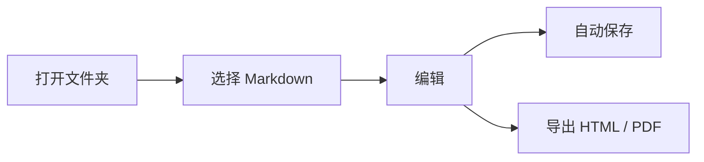

# 欢迎使用 ReadMD

ReadMD 是一个**本地优先**的 Markdown 阅读与编辑工具。你的文件始终以普通 `.md` 文件保存在自己的磁盘上，不会被导入到任何数据库。


## 你可以做什么

- 打开一个文件夹，在左侧文件树中浏览所有 Markdown 文档
- 用类似 Typora 的“即时渲染”方式写作，光标所在行才显示语法标记
- 同时打开多个标签页，按 `Ctrl+S` 保存，或等待自动保存
- 粘贴/拖拽图片，自动保存到当前文档旁边的 `assets/` 文件夹
- 一键切换深色模式，支持查找、导出 HTML / PDF
- 所有懒加载资源都在本地，断网也能正常编辑

## 常用快捷键

| 快捷键 | 功能 |
| --- | --- |
| `Ctrl+S` | 保存当前文件 |
| `Ctrl+Shift+S` | 另存为 |
| `Ctrl+O` | 打开文件 |
| `Ctrl+Shift+O` | 打开文件夹 |
| `Ctrl+N` | 新建文件 |
| `Ctrl+W` | 关闭当前标签 |
| `Ctrl+F` | 在当前文档中查找 |
| `Ctrl+Shift+D` | 切换深色模式 |
| `Ctrl+Shift+E` | 显示/隐藏左侧文件树 |
| `Ctrl+Tab` | 切换到下一个标签 |

## 代码高亮

```js
function greet(name) {
  const message = `你好，${name}！`;
  console.log(message);
  return message;
}

greet('ReadMD');
```

## 任务列表

- [x] 打开一个文件夹
- [x] 编辑这篇示例文档
- [ ] 按 `Ctrl+S` 保存
- [ ] 打开深色模式看看效果

## 数学公式

行内公式：$E = mc^2$

块级公式：

$$
\int_{-\infty}^{\infty} e^{-x^2}\,dx = \sqrt{\pi}
$$

## 流程图



## 引用与提示

> 小建议：第一次使用前，可以先用 Git 或复制一份文件做备份。
>
> ReadMD 保存时会像 Typora 一样对 Markdown 做轻度规范化，例如统一列表符号和空行。

---

更多说明见项目根目录的 `README.md`。
